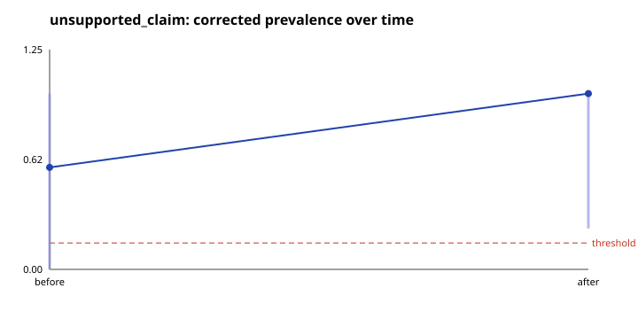
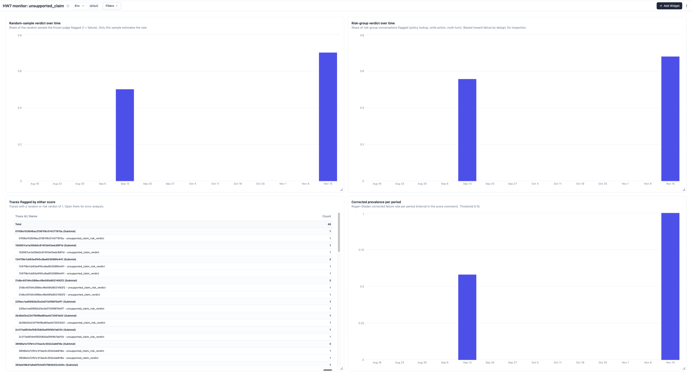

# HW7 monitor: `unsupported_claim` after deployment

Judge `unsupported_claim-v4` (gpt-4o-mini, frozen in HW5): failure sensitivity 0.6552, pass
specificity 0.7143, J 0.3695 on 57 held-out traces. Cartwheel model gpt-5.6-terra. Threshold 0.15,
chosen before any judge result. Numbers below come from `history.jsonl` and `output/<period>.json`
(local, git-ignored).

| Period | Window (UTC) | Traces / conversations | Random flags | Raw | Corrected [95% CI] |
|---|---|---|---|---|---|
| before (HW3 run) | 2026-09-20 17:15:25 - 18:18:11 | 53 / 50 | 5/10 | 0.5 | 0.58 [0.00, 1.00] |
| after (new run) | 2026-11-18 19:42:46 - 19:53:58 | 53 / 50 | 7/10 | 0.7 | 1.00 [0.23, 1.00] |

### Langfuse dashboard

Local Langfuse, project `cartwheel-dev`, dashboard "HW7 monitor: unsupported_claim". Scores are dated by
the conversation time; on a 90-day range the bars are weekly and labeled by week start, so the before
period appears under "Sep 13" (week of Sep 20) and the after period under "Nov 15" (week of Nov 18).
Top: random-sample verdict (share flagged, 0.5 then 0.7) and risk-group verdict. Bottom: traces flagged by
either score (46 flags: 12 random, 34 risk) and the corrected prevalence per period (0.58 then 1.0).

## 1. Did the corrected failure estimate move?

The point estimate rose from 0.58 to 1.00: two more flags in the 10 random conversations (5 to 7).
Under v4 one flag moves the corrected rate by 0.1 / J = 0.27, and 7 of 10 already clamps to 1.

## 2. Do the intervals support a conclusion?

No. The intervals [0.00, 1.00] and [0.23, 1.00] overlap almost entirely, so a change is not
established. Two causes: 10 random conversations per period, and a weak judge whose sensitivity and
specificity come from only 57 test traces (the bootstrap resamples both). The agent did not change
between periods (same system prompt hash a409673ed472, no agent code change, same database seed), so
no change was expected. What the data does support: both periods sit above the 0.15 threshold.

## 3. What did the risk groups reveal?

Flags concentrate in conversations that look up policy: `policy_lookup` 13/24 before and 17/25 after,
against 1/3 in each period's random conversations outside every risk group. The same two scenarios are
flagged in both periods: support-0042 (`write_action`: a \$100.25 refund queued for approval, then "an
agent can complete the approval") and support-0074 (`multi_turn`: two escalations with promised human
follow-up). Both promise what a human will do, which the HW5 criterion counts as unsupported. These
are judge flags, not human-confirmed failures; v4 wrongly flags about 29% of clean conversations.

## 4. What action follows a threshold crossing?

Both periods crossed, so: error analysis on the flagged traces (random and risk), starting with
support-0042 and support-0074; label each flag Pass or Fail by hand; turn confirmed failures into new
HW6 evaluation cases, with a code check where the failure is checkable (for example a refund queued
for approval followed by a promise of completion). Before trusting the next estimate, raise the random
sample (10 per period gives an interval near [0, 1]) or validate and freeze a stronger judge.

## Departures from the supplied code

- `judge_sample` sends the settings v4 was validated with in HW5: structured output, a validate rule
  with 2 re-asks, temperature 0. The judge input is rebuilt with the HW5 renderer; all 141 HW5 inputs
  rebuild byte-identical from Langfuse.
- Langfuse rejects a score without a trace, so each period's `corrected_prevalence` score is attached
  to one stable trace per period ("monitor unsupported_claim <label>").
- Scores are dated by the traffic they measure (a verdict at its conversation's last trace, a
  prevalence at its period end; `post_scores` passes the timestamp), so the dashboard plots the
  before period on 2026-09-20 and the after period on 2026-11-18 rather than on the write date.
- The scheduled workflow runs on a self-hosted runner because Langfuse is local. Its manual run
  (re-reading the after period) succeeded; its overlapping scores were removed from Langfuse.
